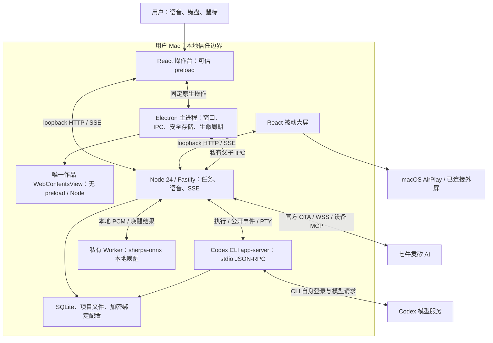
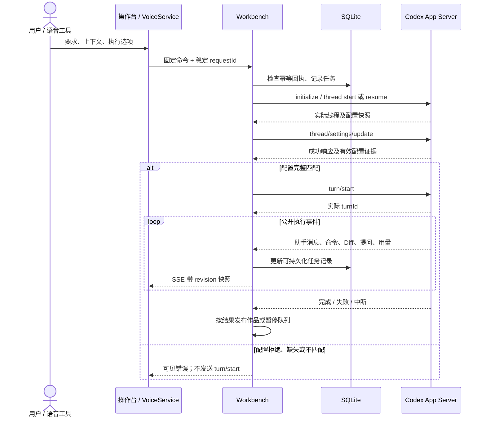
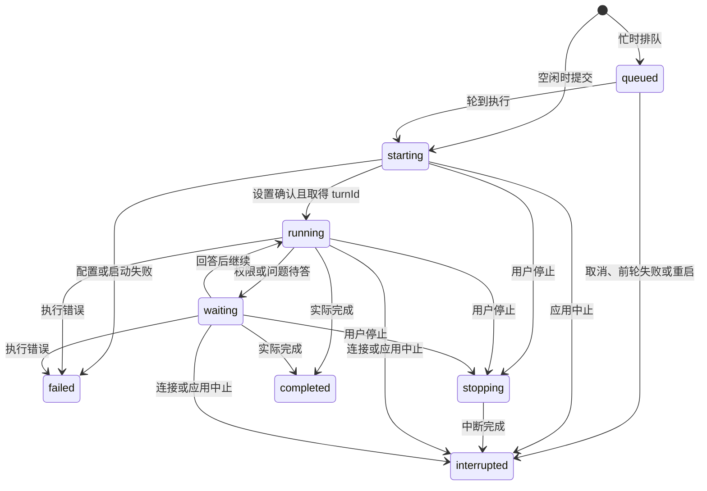
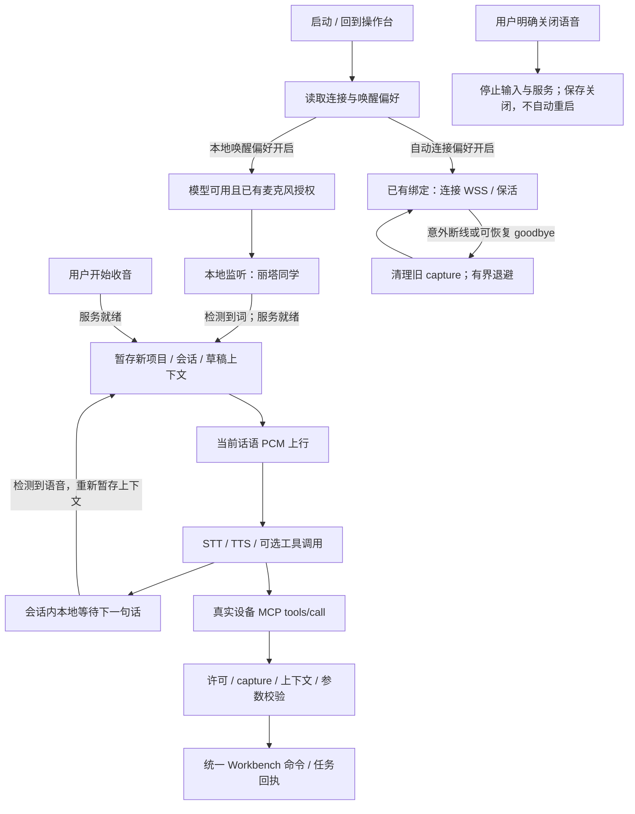

# 丽塔同学共创工作台

[](https://github.com/qiniu-ued/lingxi-product-prototype/actions/workflows/ci.yml)
[](https://app.codecov.io/gh/qiniu-ued/lingxi-product-prototype)

在沙发或会议室里提出想法，让本机 Codex 制作产品，大家在大屏上看进展、体验作品，再用语音、鼠标批注或键盘继续修改。产品名称是「丽塔同学」，语音提供方为七牛灵矽 AI；代码、协议及数据路径保留 `Lingxi` 技术标识。

完整工作区采用 **Electron + React + TypeScript + Node.js 24 + SQLite**，包含常驻 Codex 会话、公开执行进度、终端、Diff、会话分支、选段 Sidechat、唯一作品预览与语音绑定向导。桌面应用负责本机能力；单独运行网页服务提供建议保存与双端同步基础模式。设计师原始演示保留在 [`source/`](source/) 和根 [`dist/`](dist/)，其中预设剧情不能作为真实执行证据。

目录：
- [项目 Demo](http://t4q5ekzxm.hn-bkt.clouddn.com/lingxi-product-prototype.mp4)：产品演示视频
- [运行指南](#run)：安装、连接、开发、停止与更新
- [日常操作](#use)：电脑、大屏、会话和语音入口
- [系统架构](#architecture)：部署拓扑、模块和接口
- [Codex 执行架构](#codex)：设置确认、任务、输出和会话
- [作品预览与批注](#preview)：同一页面与版本校验
- [语音架构](#voice)：绑定、唤醒、工具交接与恢复
- [权限与安全](#security)
- [存储、迁移与诊断](#storage)
- [测试、构建与交付](#delivery)
- [故障排查与实现边界](#limits)
- [进一步阅读](#references)

<a id="run"></a>

## 运行指南

### 选择运行方式

| 方式                    | 前置条件                                | 提供的能力                                                                                |
| ----------------------- | --------------------------------------- | ----------------------------------------------------------------------------------------- |
| Mac 桌面 ZIP            | 对应架构的 macOS，另行配置 Codex 与语音 | 完整工作区；内置 Node、npm 和服务，日常启动与退出无需终端                                 |
| 桌面源码开发            | Node 24.x、npm 11.x、仓库访问权限       | 同一完整工作区；改代码后重新编译启动                                                      |
| 浏览器源码 / 终端运行包 | Node 24.x；开发还需 npm 11.x            | 建议保存、同步及基础页面；没有桌面桥，不能执行真实 Codex 任务或使用桌面语音、共享预览控制 |
| 设计师原始原型          | Python 3                                | 静态交互演示，不运行真实任务                                                              |

交付目标为 macOS Apple Silicon 和 Intel，原生依赖须与目标 CPU 架构匹配。Linux 用于开发与自动化 Electron 验证；本地 Linux 通过不等于 Mac 音频或 AirPlay 通过。目前没有 Windows 桌面发行包。

### 安装 Mac 桌面包

从 [Actions → CI](https://github.com/qiniu-ued/lingxi-product-prototype/actions/workflows/ci.yml) 中完成相应检查和打包的运行下载 `runtime-macos-15-<commit>`（Apple Silicon）或 `runtime-macos-15-intel-<commit>`（Intel）。解开 artifact，再解开 `Lingxi-<version>-darwin-arm64.zip` 或 `Lingxi-<version>-darwin-x64.zip`，将 `Lingxi.app` 拖到「应用程序」并打开。校验文件随包提供。

当前包未签名、未公证；可信来源包的 SHA-256 校验与 macOS 首次放行步骤见[部署文档](docs/deployment.md)。不要关闭全局 Gatekeeper。组织禁止未签名应用时需等待签名版本。应用没有自动更新；Actions 额度或计费限制会导致新提交没有新包，此时可在自己的 Mac 从源码运行或打包。

### 从干净 checkout 启动完整工作区

先安装 Node.js 24.x 和 npm 11.x；版本要求见 [package.json](package.json) 和 [.nvmrc](.nvmrc)。私有仓库还需要本机已有的 GitHub 访问权限。

```sh
git clone https://github.com/qiniu-ued/lingxi-product-prototype.git
cd lingxi-product-prototype
node --version
npm --version
npm ci
npm run desktop:dev
```

`desktop:dev` 先构建所有工作区，再启动 Electron；桌面服务使用随机 loopback 端口，由应用管理。它不是 Vite 热更新入口，修改源码后需退出应用并重新运行该命令。Linux Electron 需要图形环境或测试用虚拟显示环境；本项目的正式分发脚本面向 Mac。

### 首次连接 Codex 与语音

启动时并行检查 Codex CLI/账号、已有语音配置、唤醒模型/原生模块和麦克风状态；缺项或检查失败会进入 `/setup` 并定位对应分类。检查本身不安装、不登录、不绑定设备、不执行模型任务，也不申请麦克风权限。可以点击「返回工作台」先继续使用，当前页面不再强制进入向导；刷新或重启会重新检查。首次配置与日常管理共用「工作区 → 连接向导」，检查通过也不会自动离开向导页。
1. **配置 Codex。** 在连接向导安装 stable latest Codex CLI，然后通过官方浏览器登录。仅安装 Codex 桌面应用仍需 CLI。也可在终端自行安装、登录：

   ```sh
   npm install -g @openai/codex@latest
   codex login
   codex --version
   ```

   CLI 选择顺序是 `LINGXI_CODEX_BIN` 指定的可执行文件、应用托管安装、系统 `PATH` 中的 `codex`。不需要把账号密码或令牌发给开发者。在「文字输入 → 模型与执行设置 → 模式说明与兼容验证」可显式验证执行设置：它使用独立临时会话，不启动模型 turn 或修改项目；普通环境检查不会创建会话。
2. **绑定丽塔同学设备。** 在连接向导中获取六位绑定码，打开[七牛灵矽控制台](https://linx.qiniu.com/)，登录自己的账号，创建/选择智能体并绑定该设备，再点击「我已绑定，检查连接配置」。应用通过官方接口获取连接配置，并交给桌面端加密保存。绑定码与 AirPlay 的系统 PIN 是两套流程。智能体需要支持工具调用的模型及「统一意图识别」，可复制连接向导的工作台角色说明；参见[官方配置说明](https://linx.qiniu.com/docs/xrobot/guide/agent-config)。角色说明只是引导，实际工具调用和任务回执才是执行证据。
3. **准备本地唤醒。** 在「连接向导 → 语音唤醒与麦克风」显式下载约 33 MB 的唤醒模型，复查原生模块，按页面指引授权麦克风。自动启动不会下载模型或弹出系统授权。模型与已有授权满足后，工作台本地监听「丽塔同学」；听到提示音后说指令。可修改本次运行的关键词，重启默认词仍为「丽塔同学」。
4. **检查三项偏好。** 「应用启动后自动连接并保持语音服务」「允许主动收音后用语音提交/停止任务、切换计划模式」「自动开启本地语音唤醒」在新安装和旧配置缺字段时默认开启。已明确保存的关闭选择保留；保存语音执行许可后需重新连接。语音执行许可不等于系统麦克风授权，也不会提高 Codex 权限。
5. **选择项目并试运行。** 右上角「新建项目」或下拉菜单「打开项目」选择允许 Codex 修改的目录。先用文字提交一个小任务，再用语音要求查询进度或修改作品，检查是否出现真实任务编号和 Codex 执行记录。没有项目也能语音聊天，但不能提交开发任务。

### 网页入口与浏览器基础模式

```sh
npm run dev
```

开发操作台为 <http://127.0.0.1:5173/>，后端为 `127.0.0.1:4310`，Vite 代理 `/api`。路径 `/display` 是被动大屏，`/setup` 是唯一连接向导，旧 `/settings` 地址会保留分类 hash 并归一到 `/setup`。不要将开发端口 5173 与应用自管的随机端口混淆。

```sh
npm run build
npm start
```

编译后的独立服务在 <http://127.0.0.1:4310/> 提供网页及 API；同样支持上述路径。浏览器不能直接执行 shell、启动本机 Codex 或操控 AirPlay。完整功能需要由桌面父进程建立的私有桥，单纯打开网页或通过环境检查不会获得这些能力。这里只绑定本机，不是面向公网的多用户部署。

桌面模式中的「项目预览」来自应用的大屏预览视图，不需要另开一个浏览器。静态作品入口为项目的 `preview/index.html`；已有框架项目可在集成终端运行自己的开发服务器，再从「工作区 → 连接项目开发服务器」显式绑定，例如 `http://127.0.0.1:5174/`。不能绑定工作台服务自己的端口。

仅查看设计师原始演示：`npm run prototype`，访问 <http://127.0.0.1:8080/>。

### 环境变量与数据位置

日常桌面使用无需填写环境变量，语音凭据通过绑定流程配置。以下变量用于开发/部署，不要把凭据写进命令或仓库：

| 变量                                | 用途与默认值                                                                                                                |
| ----------------------------------- | --------------------------------------------------------------------------------------------------------------------------- |
| `LINGXI_DESKTOP_DATA`               | 覆盖 Electron `userData` 根目录；Mac 默认 `~/Library/Application Support/Lingxi/`。桌面服务数据库、托管工具与模型跟随此目录 |
| `LINGXI_CODEX_BIN`                  | 指定 Codex 可执行文件路径，不接受 shell 命令串；优先于托管 CLI 和 `PATH`                                                    |
| `LINGXI_DB_PATH`                    | 独立 Node 服务数据库路径；直接 `npm start` 默认仓库 `.local/lingxi.db`；桌面父进程设置为其数据根下 `lingxi.db`              |
| `PORT`                              | 独立服务默认 `4310`；桌面父进程固定传 `0` 申请随机空闲端口                                                                  |
| `LINGXI_WEB_ORIGIN`                 | 允许的额外前端 Origin；用于受控开发，不能用来开放任意来源                                                                   |
| `LINGXI_NODE_BIN`、`LINGXI_NPM_CLI` | 启动器内部选择配套 Node/npm；`desktop:dev` 与桌面包自动传入，不需手动配置                                                   |
| `LINGXI_PREVIEW_MCP_TOKEN`          | 桌面每次启动随机生成的内部预览鉴权令牌，不是用户配置，不应复制、固定或导出                                                  |

例如单独运行已构建的基础服务：

```sh
LINGXI_DB_PATH="$PWD/.local/demo/lingxi.db" PORT=4311 npm start
```

终端运行包的 `./start.sh` 经 `start-runtime.mjs` 启动：Mac 默认使用上述 Application Support 目录，Linux 使用 `${XDG_DATA_HOME:-~/.local/share}/lingxi/`。这与直接 `npm start` 的开发数据库默认值不同。修改数据根会切换整套本地状态；不要把空目录误认为历史丢失。

### 停止、重启与更新

- 桌面菜单「退出丽塔同学」或关闭操作台窗口会退出应用，清理语音、唤醒 Worker、本机服务和自有 Codex/PTY 进程。关闭大屏窗口只隐藏大屏；「工作区 → 打开大屏」可重新打开。
- 源码的 `npm run dev` / `npm start` 与终端运行包使用 `Ctrl+C` 停止；源码桌面开发退出后重新运行 `npm run desktop:dev` 加载修改。
- 更新源码前先退出应用，提交/暂存自己的代码修改，再执行 `git pull --ff-only`、`npm ci`、`npm run desktop:dev`。桌面 ZIP 更新则退出旧应用后替换 `.app`。两种方式都不应删除数据目录或项目目录。
- 文件复制备份须先完全停止服务，备份应用数据根及实际项目目录，注意 SQLite 的 `-wal` / `-shm` 文件。账号 CLI 状态由 Codex 自己管理，不在应用备份中保证覆盖。应用版本回退不等于数据库回退；不要删除新表来“修复”兼容问题。
- 停止任务、退出或切换会话都不会撤销已经写入的文件；未完成任务重启后标为中断，不自动重放。未发送草稿及内存语音记录不会跨应用退出保存。

<a id="use"></a>

## 日常操作

默认暖色双栏展示作品和对话，底栏是语音状态与文字输入；辅助功能折叠在「工作区」「文字输入」和「本轮详情（⋯）」。工作区按钮与新建项目保持同一风格；其中「项目工具」默认折叠，展开后提供预览、终端、Diff、工具与额度及从上方项目显示操作迁入的「点选修改」。

| 入口                      | 行为                                                                                                                                                                                        |
| ------------------------- | ------------------------------------------------------------------------------------------------------------------------------------------------------------------------------------------- |
| 工作区 → 连接向导         | Codex 安装/登录、设备绑定、执行许可、唤醒模型/词、麦克风与诊断。页面内往返保留工作台草稿；进入向导停止音频所有者，返回仅按偏好和现有权限恢复本地唤醒，不恢复旧云端收音                      |
| 对话区会话列表            | 当前项目的会话、搜索、新建及「返回原对话」。搜索不隐藏当前选项；任务进行中不能切换或另建分支，切换不终止任务或回滚文件                                                                      |
| 文字输入 → 模型与执行设置 | 从 CLI 实际返回的模型及 Reasoning Effort 中选择；执行/计划模式和三档权限用于后续提交，已排队/执行中的任务保留提交时设置                                                                     |
| 工作区 → 项目工具 → 终端 / Diff      | 项目 PTY；选段可加入对话。Diff 区分本轮 patch、Git 暂存与未暂存修改，可选行评论；停止模型任务与结束终端是不同动作                                                                           |
| 预览旁「批注修改」        | 悬浮高亮元素并显示尺寸，点击锁定，填写批注或指令后提交；Esc 取消，滚轮浏览。选取不会触发页面原有按钮/表单                                                                                   |
| 历史消息选段浮动工具栏    | 「引用到对话」或「选段 Sidechat」，最多 16,000 字符；只暂存草稿，不自动执行。Sidechat 结果可选段引用回原对话                                                                                |
| 每轮 Fork / 复制图标      | Fork 继承截至该已结束轮次的对话；复制该轮回复。Fork 共享项目文件，不创建 Git 分支/worktree                                                                                                  |
| 本轮详情（⋯）             | 电脑侧查看执行记录、命令公开输出、Diff 和已报告的本轮用量。无用量报告则不显示；已知用量用灰色小字，如 `32,000 Token used, 30,000 Input, 2,000 Output, 40.0% Cache hit.`；未知缓存命中率省略 |
| 上下文进度条              | 电脑和大屏均显示；hover/focus 提示 `Context Window: xx/xx used.`，点击或语音打开详情，展开状态共享。未知容量/占用不显示假百分比                                                             |
| 工作区 → 项目工具 → 工具与额度       | Skills、MCP、limits 的可读列表、连接/授权状态与额度窗口；分类失败独立提示，不向用户倾倒提供方 JSON                                                                                          |

Codex 公开提供的多条中途助手消息和最终回复逐条显示；命令实时输出在电脑侧执行记录展开。大屏保持被动展示，没有麦克风或配置所有权。应用启动默认打开大屏，优先放到已有外接屏；AirPlay 由用户在 macOS 控制中心连接，系统 PIN 由 macOS 管理，应用不会自动授予录屏权限或连接电视。

<a id="architecture"></a>

## 系统架构

### 系统上下文与部署拓扑

这是单用户、单台 Mac 的本地协调系统。Electron 管进程与原生能力，Node 服务是任务及会话的权威状态源，React 负责输入和显示。Codex 与语音服务是两条独立外部链路，屏幕投送另由操作系统处理。



进程启动顺序为 Electron → 独立 Node 24 子进程 → loopback 监听与私有 IPC ready → 操作台和默认大屏。SQLite 运行在 Node 子进程中，避免 Electron ABI 与 Node 原生模块混用。桌面包自带 Node/npm；源码启动器使用当前合规 Node。

### 模块职责与源码位置

| 模块                   | 职责 / 主要文件                                                                                                                                                                                                                                                                                                                  |
| ---------------------- | -------------------------------------------------------------------------------------------------------------------------------------------------------------------------------------------------------------------------------------------------------------------------------------------------------------------------------- |
| `apps/desktop/`        | [`main.ts`](apps/desktop/src/main.ts) 管窗口、项目选择、加密配置和服务启动；[`preload.ts`](apps/desktop/src/preload.ts) 暴露受限原生操作；[`service-process.ts`](apps/desktop/src/service-process.ts) 管子进程/IPC 退出竞态                                                                                                      |
| 桌面预览               | [`preview.ts`](apps/desktop/src/preview.ts)、[`assets.ts`](apps/desktop/src/assets.ts)、[`inspect-element.ts`](apps/desktop/src/inspect-element.ts)：唯一视图、冻结资源、元素命中与坐标映射                                                                                                                                      |
| `apps/server/`         | [`app.ts`](apps/server/src/app.ts) / [`workbench-routes.ts`](apps/server/src/workbench-routes.ts) 为边界校验和路由；[`workbench.ts`](apps/server/src/workbench.ts) 协调任务、队列、会话、Codex 和预览                                                                                                                            |
| Codex 适配             | [`codex-client.ts`](apps/server/src/codex-client.ts) stdio 协议与设置确认；[`execution.ts`](apps/server/src/execution.ts) 模式/权限投影；[`codex-setup.ts`](apps/server/src/codex-setup.ts) 安装与官方登录                                                                                                                       |
| 语音适配               | [`voice-binding.ts`](apps/server/src/voice-binding.ts) 官方设备绑定；[`voice.ts`](apps/server/src/voice.ts) 连接、PCM、设备 MCP、交接和恢复；[`wake-model.ts`](apps/server/src/wake-model.ts) / [`wake-worker.ts`](apps/server/src/wake-worker.ts) 模型与本地推理                                                                |
| 存储与统计             | [`workbench-store.ts`](apps/server/src/workbench-store.ts)、[`store.ts`](apps/server/src/store.ts)、[`turn-usage.ts`](apps/server/src/turn-usage.ts)：SQLite 状态、幂等回执及用量归属                                                                                                                                            |
| `apps/web/`            | [`DesktopWorkbench.tsx`](apps/web/src/DesktopWorkbench.tsx) 工作区；[`ConversationNavigation.tsx`](apps/web/src/ConversationNavigation.tsx) 会话导航；[`VoiceControls.tsx`](apps/web/src/VoiceControls.tsx) 音频所有者；[`SettingsPage.tsx`](apps/web/src/SettingsPage.tsx) / [`SetupPage.tsx`](apps/web/src/SetupPage.tsx) 配置 |
| `packages/protocol/`   | 共享 Zod schema、TypeScript 类型和适配合同；HTTP、IPC 与提供方事件在边界验证，不信任原始 payload                                                                                                                                                                                                                                 |
| `scripts/`、`.github/` | 真进程 smoke、浏览器/桌面验收、按架构打包及 CI；[`AGENTS.md`](AGENTS.md) 约束后续开发                                                                                                                                                                                                                                            |
| `docs/adr/`            | 架构决策记录；早期方案与后续 ADR 冲突时，以当前实现和后续决策为准                                                                                                                                                                                                                                                                |

### 通信与能力边界

| 通道                                                   | 用途 / 约束                                                                                           |
| ------------------------------------------------------ | ----------------------------------------------------------------------------------------------------- |
| `/api/workbench`、`/api/workbench/:operation`          | 任务、会话、草稿上下文等固定操作；桌面桥存在才有真实工作区能力                                        |
| `/api/workbench/events`                                | SSE 初始及后续带 revision 的工作区快照，包含公开消息/活动；15 秒注释心跳，断线后重连取当前状态        |
| `/api/session`、`/api/commands`、`/api/events`         | 独立浏览器基础模式的建议保存与双端同步；命令 ID 与 expectedRevision 防重复/过期修改，不代表启动 Codex |
| `/api/setup`、`/api/setup/check`、`/api/setup/codex/*` | 只读诊断与单独的显式安装/登录/取消操作；不是任意 shell 接口                                           |
| `/api/voice/*`                                         | 配置状态、绑定动作、连接/收音、语音会话与诊断；不通过 HTTP 返回绑定秘密                               |
| `/mcp/preview`                                         | Codex 访问唯一预览的受限工具；每次桌面启动的 Bearer 令牌、版本化绑定和元素引用共同校验                |
| Electron preload / 私有 IPC                            | 仅受信主框架可请求固定且经 schema 验证的原生动作；生成的作品页面无此桥                                |
| Codex stdio / 语音 WSS                                 | 各自独立协议；Codex 在本机执行任务，云端语音智能体通过设备 MCP 请求同一工作台命令                     |

<a id="codex"></a>

## Codex 执行架构

### CLI 生命周期与严格设置确认

应用启动的是用户本机 `codex app-server`，通过 stdio JSON-RPC 交互，不控制官方 Codex 桌面 UI。客户端随项目使用并恢复已持久化的 Codex thread；普通只读检查与执行客户端分离，检查通过不等于开始模型任务。



提交前必须成功调用 `thread/settings/update`，并核对服务端实际生效的模式、模型、effort、cwd、审批策略/reviewer，以及请求中的所有 sandbox 字段。完整且验证通过的 `thread/start`、`resume`、`fork` 响应可以建立当前客户端的确认缓存，`resume` 必须匹配目标 thread；发生变化时需匹配的 `thread/settings/updated` 通知。CLI 对无变化设置可能不再发通知，因此使用已取得的实际快照确认；UI 选择、请求参数、空 ACK 或超时都不能当作生效证据。缺失/不兼容时失败关闭，不降级执行。

模型来自分页 `model/list`，只展示该模型支持的推理强度。计划/执行使用官方实验性 `collaborationMode` 的 `plan` / `default` 与 `developer_instructions: null`，不是拼一句“先给计划”的提示词。组织管理策略及 CLI 版本可能限制可用选项。

### 任务状态、排队与输出



同一工作区串行执行；用户可排队下一轮或补充当前轮。任务设置在提交时捕获，之后改模型/模式/权限不影响已入队任务。持久化 requestId 回执避免重试重复执行；不确定是否送达的补充也预留回执，不自动重发。失败或中断暂停队列；静态作品发布结束后才调度下一轮。停止调用中断协议，必要时关闭客户端；恢复应用将未完成任务记为 interrupted，不重放。

`turn/start` 返回前到达的通知先缓存，取得真实 turnId 后只接收匹配 thread/turn 的事件。公开 `agentMessage` 分片、item 开始/完成与最终快照按首次观察到的稳定顺序合并，完成快照替换同 ID 内容，不把中途消息覆盖成一条最终答复。`commandExecution/outputDelta` 追加到对应命令输出，单项保留有界文本；PTY 输出另行处理。内部 reasoning 不展示，未适配的协议事件不承诺完整呈现。

服务将公开输出、命令状态、Diff、审批/问题及任务结果归入对应任务并持久化，SSE 推送带 revision 的快照；刷新/重连取当前已保存状态，前端拒绝旧 revision。权限请求和提问按任务/请求 ID 回答；涉及敏感输入应使用键盘。完成表示 Codex turn 完成，不保证测试通过、预览存在或用户需求全部满足。

语音和 Codex 公开文本使用同一条消息时间线。新 Codex 消息/补充输入的本机首次观察时间与序号单独保存在 `workspace_message_times_v1`，流式更新及最终快照沿用原位置；语音使用已有消息时间，关联任务不再把整段回复挪到任务前。相同时间采用稳定次序；旧任务缺少逐条时间，保留原轮次内顺序，不编造精确历史交错。此元数据不把语音正文持久化，也不改变严格 Task/v2 JSON。

上下文占用取 `tokenUsage.last.totalTokens / modelContextWindow`；本轮消耗取整轮累计计数的差值，不把多次请求的最后一笔当整轮，也不重复相加快照。缓存命中率为本轮 cached input / input；无可靠基线、计数重置、未知值或零输入时不伪造百分比。迟到报告只能修正对应轮次，不覆盖较新上下文。

### 会话、Fork、Sidechat 与草稿

一个项目可有多个工作台会话，各自关联 Codex thread、任务历史与 `parentId`。会话列表只展示当前项目，搜索保留当前选中项；Fork/Sidechat 后可直接返回原对话，保留子会话。运行中禁止切换，不能把其他会话事件接入当前对话。会话选择不写浏览器历史；浏览器后退不是会话返回机制，重新载入后从已保存状态/列表恢复导航。

Fork 继承截至选定已结束轮次的 Codex 历史，不自动执行任务。Sidechat 从历史选段建立只读 Fork，把引用放入新草稿，待用户输入并提交；禁用所有发现的 MCP 服务器及其插件，发现失败则拒绝执行。两者都**共享项目文件**，不创建 Git 分支、worktree 或文件快照；返回原对话不回滚代码。

文字、元素批注、选择和附件草稿按项目/会话保留在当前页面内存；页面内切会话/进出连接向导不丢草稿，异步操作固定原目标并检查是否过期。刷新或退出不恢复未发送草稿。被明确提交的任务正文/上下文另随任务持久化。

<a id="preview"></a>

## 作品预览与批注

大屏窗口持有唯一的产品 `WebContentsView`，电脑端显示该页面的实时截图，Codex 的预览 MCP 也操作这个实例。这样人工看到的作品与 Agent 操作的作品一致，不使用两个独立浏览器页面假装同步。
- **静态作品：** 完成后从项目 `preview/index.html` 冻结受支持的本地资源，发布为版本化预览；未变化作品不会因为点击/投票等页面交互而强制刷新。项目浏览器存储独立保留。
- **已有框架项目：** 用户显式绑定 loopback 开发服务器，允许精确项目 Origin 及配套 HMR WebSocket；拒绝工作台服务自身端口与任意外部网络。HMR 修订不是不可变源码快照。
- **元素批注：** 在唯一页面的隔离世界做只读 hit-test，在电脑截图上绘制轮廓；处理留白、缩放、滚动与尺寸变化，点击锁定时不触发原页面动作。Esc/取消清理状态，过期异步命中丢弃。同源且轴对齐 iframe 支持内部元素；跨源、不透明或变换 iframe 回退选择框架元素。
- **提交与自动操作：** 元素上下文携带项目、binding、revision、epoch 与元素 ref，提交及每次预览操作重新校验，旧页面引用拒绝。Codex 可经固定工具读取快照、点击、输入、滚动；不是任意 JavaScript、桌面控制或 shell 接口。

截图与任务执行状态独立：本机同一版本的截图请求合并为单个进行中的操作，每个等待者最多等 4 秒；电脑侧 5 秒未返回也显示错误。连续截图失败最多尝试三次，失败后按 1.2 / 2.4 秒退避，再停止自动重试；用户可打开大屏并点击「重试同步预览」。保留当前版本上次成功截图并标明未更新，换版本立即拒绝旧图；失败时禁用基于旧图的新批注点选。底层 Electron/GPU 截图故障仍需单独诊断，超时提示不代表截图已恢复。

生成页面没有 Node、preload 或 IPC，不能访问本机工作台 API/秘密；外部 CDN/API 也不默认放行。电脑截图不是第二个交互实例，普通体验可操作大屏窗口，或要求 Codex 操作唯一预览。更详细边界见[桌面预览 ADR](docs/adr/0003-desktop-canonical-preview.md)。

<a id="voice"></a>

## 语音架构

### 绑定与音频链路

绑定仅使用官方 OTA `https://xrobo.qiniuapi.com/v1/ota/` 和 WSS `wss://xrobo-io.qiniuapi.com/v1/ws/`。应用生成稳定设备/client 标识，获取激活码，用户在官方控制台选择智能体；检查激活后重新取得 WSS 连接信息，通过私有 IPC 保存到 Electron `safeStorage`。不下载 OTA 固件，不读取系统网卡身份，不在应用中索取控制台密码。当前握手依赖设备绑定，不自动指定或修改云端智能体。

麦克风由可信操作台的 `getUserMedia` 获取，经 [`pcm-worklet.js`](apps/web/public/pcm-worklet.js) 整理为 **PCM16LE / 16 kHz / 单声道 / 20 ms（640 bytes）**，通过受限桥与私有 IPC 到 Node，按协议发给语音服务。服务必须协商兼容 PCM；Opus 不当 PCM 解释。TTS 经私有 IPC 返回操作台播放。被动大屏不会申请麦克风。

本地唤醒使用私有 sherpa-onnx Worker；固定模型下载地址、SHA-256、体积/时间及解包成员校验，未验证模型不能进入推理。麦克风请求回声消除、降噪与自动增益，实际生效状态另由 `getSettings` 核验。代码没有直接录制系统输出音频、`getDisplayMedia` 或系统 loopback 录音路径；系统默认输入若是虚拟回环设备，或电脑外放被物理麦克风拾取，仍会收到电脑声音。自身 TTS 播放及尾音有抑制，不能保证过滤其他播放器/所有声学回声；[音频审计和 Mac 对照方法](docs/audio-input-and-echo.md)说明了验证边界。

### 连接、唤醒与收音是独立状态



启动自动连接已有绑定并启动满足条件的本地唤醒；首次权限/模型/绑定缺失给配置入口，不绕过系统授权。待唤醒及会话内待说话的音频留在本地；识别唤醒或用户开始收音后，当前话语才上传，每句话重新绑定上下文。静音结束单句分段，不主动关闭语音会话；60 秒分段上限不是会话超时，4 秒音频租约检查的是帧中断，不是安静样本。

「关闭语音」或真实 `workbench_voice_close` 停止输入/播报、断开服务并保存连接与唤醒两项关闭，重启不恢复；仅关闭唤醒不必断开服务，仅断开服务可保留本地待唤醒。停止播报、停止 Codex 任务、关闭语音也是三件事。进入连接向导、音频丢失、休眠或退出释放当前采集；网络恢复永不恢复旧 capture、重放旧语音或任务。向导返回可按已有授权和偏好恢复本地唤醒。

旧配置迁移：新/缺字段默认开启；明确标为 `legacy-review` 的旧默认迁移为开启；已保存 false（包括不能辨别来源的无标签 false）保留关闭。损坏或不可写的偏好失败关闭并提示，不猜测用户授权。

### 云端设备 MCP 到 Codex

| 工具                        | 能力 / 关键限制                                                                           |
| --------------------------- | ----------------------------------------------------------------------------------------- |
| `workbench_status`          | 读取当前工作台状态；日志可区分实际调用与口头回答                                          |
| `workbench_submit`          | 把需求交给同一 Workbench，返回真实 task ID；需当前项目、有效 capture/暂存上下文与执行许可 |
| `workbench_interrupt`       | 请求停止当前任务，经过对应上下文与许可校验                                                |
| `workbench_set_mode`        | 切换后续提交的计划/执行模式，不改变已提交任务，不提高权限                                 |
| `workbench_context_details` | 电脑/大屏打开或收起共享上下文详情，不启动模型 turn                                        |
| `workbench_voice_close`     | 关闭语音；需当前有效语音上下文，但不需要任务执行许可，不能停止 Codex 或提高权限           |

云端智能体是设备 MCP 客户端，本机服务提供工具。`tools/list` 只证明它读取工具列表；STT、TTS、“好的，我来改”都不证明工具执行。`tools/call` 经校验、入队并取得 task ID 才显示已提交；任务完成/失败另关联真实 runner 结果。语音提交复用 capture 对应稳定 requestId，普通转写不会再执行第二次。执行许可关闭时明确提示并允许保留转写草稿。消息显示用户/助手来源、流式/最终状态和交接结果，无项目时也能显示当前语音聊天。

### 保活、断线与远端 goodbye

WebSocket 每 20 秒 ping，45 秒未收到 pong 视为失联；可恢复故障采用 1、2、4、8、16、30 秒退避，最多六次连续重试，稳定连接 30 秒后重置失败预算。认证/协议不兼容停止重试，预算耗尽明确提示。显示真实连接状态，用户主动关闭优先于 online/resume/唤醒事件。

对当前连接明确发来的 `goodbye`，若无等待回复的新鲜语音请求、也没有普通用户回复正在播放，立即退役旧连接、清空告别音频队列并按上述策略重连；已经运行的本地唤醒保留。若仍有有效请求/普通回复，则保守保留回复并等待远端关闭，协议没有足够字段区分告别原因。不会发送假用户话语、listen 或音频作为心跳，不会恢复旧收音。Codex 已提交任务继续独立执行。

曾观察到约 120 秒的远端告别，而控制台显示 3600 秒；**实际生效的云端配置及告别根因尚未确认**。官方空闲计时与 WebSocket 传输保活不是同一件事，不能用加 ping 证明已修复，也不能承诺同一云端会话永不断开。当前实现改善的是可恢复性和空闲告别体验，详见 [ADR 0015](docs/adr/0015-remote-goodbye-recovery.md)。

<a id="security"></a>

## 权限与安全

Codex 任务权限以实际服务端确认的组合为准：

| UI 选项          | sandbox                   | approvalPolicy | reviewer      |
| ---------------- | ------------------------- | -------------- | ------------- |
| Manual           | `workspaceWrite`          | `on-request`   | `user`        |
| Approve for me   | `workspaceWrite`          | `on-request`   | `auto_review` |
| Full Access      | `dangerFullAccess`        | `never`        | `user`        |
| Sidechat（固定） | `readOnly`，禁用 MCP/插件 | `never`        | `user`        |

Manual / Approve for me 的 writableRoots 为当前项目，默认 `networkAccess: false`；Sidechat 也禁用网络。应用不自动点击同意来模拟 `auto_review`；CLI/组织不支持时不可启动该设置的 turn。语音只控制支持的任务/模式动作，不能提升权限。

集成终端是用户有意打开的独立 PTY，经 `command/exec` 启动应用选定的登录 shell，cwd 为项目目录，固定 `workspaceWrite` sandbox 且允许网络；不继承模型 turn 的权限档位。API 不接受任意 executable/argv，模型/设备/预览 MCP 不提供终端入口，Sidechat 不开放 PTY。实际 shell 输入仍由用户负责。

本机 HTTP 绑定 `127.0.0.1`，校验 Host/Origin，无通用跨域开放。受信工作台窗口隔离上下文、关闭 Node 集成；原生动作检查调用框架并验证 schema。作品页面无 Node/preload/IPC，预览 MCP 使用私有鉴权与版本校验。它不是恶意本机进程之间的安全隔离层，也不是可直接公网部署的账号系统。

绑定秘密使用 Electron `safeStorage` 加密写入 `voice-config.enc`，临时文件原子替换、限制权限；安全存储不可用或仅不安全明文后端时拒绝保存。CLI 自行管理 Codex 登录。SQLite 中已提交的聊天/项目内容并非加密数据库；诊断秘密脱敏不等于所有内容都可公开分享。

退出流程先阻止新操作和重连，再关闭桥、音频、Worker、Codex/终端和服务，幂等且有界等待。IPC 发送同时检查 connected 并持有发送回调处理关闭竞态；不全局吞掉 `ERR_IPC_CHANNEL_CLOSED` 或非退出期错误。

<a id="storage"></a>

## 存储、迁移与诊断

### 持久数据与内存边界

| 数据                                       | 位置 / 生命周期                                                                                                                  |
| ------------------------------------------ | -------------------------------------------------------------------------------------------------------------------------------- |
| 工作台状态、会话、任务、公开输出、幂等回执 | `lingxi.db`（SQLite WAL）；`workspace_state_v2` / `workspace_turns_v2`。基础浏览器状态使用 `session` 表                          |
| 模型/上下文、每轮用量、权限偏好与任务权限  | 分别为 `workspace_thread_runtime_v1`、`workspace_turn_usage_v1`、`workspace_permissions_v1`，与严格 v2 JSON 分离                 |
| 公开消息顺序元数据                         | `workspace_message_times_v1`；只保存 task/message ID、类别、本机首次观察时间和稳定序号，不复制正文；旧记录不回填虚构时间         |
| 历史兼容数据                               | `workbench_state` / `workbench_requests` 只在 v2 首次初始化时导入；保留旧表，后续旧版本写入不反复导入                            |
| 项目注册与作品资源                         | 数据根的 `projects.json`、`artifacts/<projectId>/<version>/`；实际项目源码仍在用户选择的目录，预览浏览器分区存储由 Electron 管理 |
| 语音身份/秘密                              | `voice-device.json` 保存稳定本地身份，`voice-config.enc` 保存系统加密配置，不通过 HTTP 导出秘密                                  |
| 用户语音意图                               | `wake-preferences.v1.json`、`voice-connection-preferences.v1.json`；非秘密，独立版本化，显式关闭跨重启保存                       |
| 模型与托管 CLI                             | 数据根 `wake/`、`tools/`；与安装目录分离，更新 `.app` 不应删除                                                                   |
| 未发送草稿、选段、附件暂存                 | 仅当前网页内存；切会话/向导往返保留，刷新或退出丢失                                                                              |
| 语音聊天文本                               | 服务内存，最多 24 轮、每轮 8 消息、共 64,000 字符；刷新/语音重连保留，服务退出清空；明确提交给 Codex 的正文另随任务持久化        |
| PTY 重放缓冲、活跃连接、capture、播放队列  | 有界运行时内存；不作为刷新后继续执行的凭据，不自动重放                                                                           |
| 语音诊断                                   | 以下两类有界内存日志；无默认磁盘日志文件、无额外云上传、无原始音频录制                                                           |

HTTP schemaVersion 与数据库表后缀是不同版本概念；当前 HTTP 协议仍使用其共享 schema 中的版本。迁移遵守已有严格 Task/v2 格式，不往旧 JSON 塞新的派生遥测。数据库降级没有自动承诺；更新/回退前按运行指南备份。

### 从 UI 复制诊断日志

右侧语音交接区域的「语音诊断」，或「连接向导」中的语音诊断入口，可查看并复制：
- **复制诊断日志：** 脱敏阶段摘要，包含构建版本、时间/时区、session/capture/task 关联、工具名、阶段结果、错误类别、断开来源/关闭码和重试，不附对话正文；最多 128 条、30 分钟。
- **详细调试预览 / 独立复制按钮：** 从服务启动始终记录，无启停选项。包含 STT 原文、助手文本、工具参数/返回结构、必要协议字段及本地事件；属于经凭据脱敏的详细 payload，不是完全未修改的原始包。**含对话和项目内容，分享前必须预览。**

详细日志最多 256 条、30 分钟：96 条重要事件额度留给工具调用/结果、任务失败、告别与断开等，160 条普通事件额度用于其余协议活动；每条 payload 最多 8192 字符，深度、字段与字符串另有上限。界面/导出显示轮转丢弃、重要事件丢弃及截断计数；重要事件也可能用完额度，不能保证完整追溯。日志生成前遮盖密码、token、cookie、Authorization、绑定秘密/身份及嵌套/字符串内凭据，再做截断；不导出任意环境变量或整套配置。

关闭面板不会停止记录；清空仅清当前缓冲，后续继续记录；服务退出清空，已遗漏内容不能事后恢复。复制成功才显示成功，剪贴板失败提供可手动全选的文本。桌面服务不将这些日志自动写盘；独立基础服务的终端请求日志也不是完整语音诊断档案。无需寻找隐藏目录或发送整个数据库。

可转发给设计师的报障步骤：
1. 复现后保持应用运行，尽快打开「语音诊断」。
2. 点击「复制诊断日志」，粘贴给维护者；需要完整协议上下文时，再预览并独立复制详细调试，确认愿意分享其中内容。
3. 附发生时间和时区、版本、具体操作、预期与实际现象；注明日志是否丢弃/截断。不要发送录音、数据库、配置目录或令牌。

详细说明见[语音诊断指南](docs/voice-diagnostics.md)。

<a id="delivery"></a>

## 测试、构建与交付

### 本地命令

在仓库根目录执行，依赖通过 `npm ci` 安装：

| 命令                                                       | 检查或产物                                                                 |
| ---------------------------------------------------------- | -------------------------------------------------------------------------- |
| `npm run lint` / `npm run typecheck`                       | Biome / TypeScript 与共享协议类型                                          |
| `npm test` / `npm run test:coverage`                       | Vitest 单元/API/协议边界测试；覆盖率门槛：语句/行/函数 85%，分支 75%       |
| `npm run check`                                            | lint → typecheck → coverage → build → 真实生产进程启动/重启 smoke          |
| `npx playwright install chromium`，然后 `npm run test:e2e` | 安装浏览器并跑 Playwright；验证浏览器交互、SSE、向导/草稿/会话等           |
| `npm run test:desktop`                                     | 构建后做退出回归与真实 Electron/Node/唯一预览集成；Codex 使用可控协议替身  |
| `npm run audit:production`                                 | 生产依赖审计；不能用强制升级掩盖兼容问题                                   |
| `npm run build`                                            | 编译到各 `apps/*/dist` 与 `packages/protocol/dist`，不同于根设计师 `dist/` |
| `npm run release:pack`                                     | 构建终端基础运行包、安装目标原生依赖、解包并做真实启动检查                 |
| `npm run desktop:pack`                                     | 在目标架构 Mac 构建桌面 ZIP 与终端包，校验解包后的实际 `.app` 和内置 Node  |

实现变更跑 `check`；浏览器/SSE/命令变更加 e2e，桌面/任务/预览变更加 desktop，打包与依赖变更加对应打包/审计。协议替身验证消息和状态，不证明真实云端模型、账号或物理音频；Mac 麦克风、远场唤醒、扬声器回声、AirPlay 及特定模型组合需要独立真机验收。公开多步输出已由受控协议经过真实 SSE/渲染验证，不能声称每个模型每轮都会生成中途输出。参见[测试策略](docs/testing.md)。

### 打包产物与部署方式

所有发行产物写到 `artifacts/`，不提交 Git：

| 产物                                                             | 内容 / 启动方式                                                                                                                     |
| ---------------------------------------------------------------- | ----------------------------------------------------------------------------------------------------------------------------------- |
| `Lingxi-<version>-darwin-<arch>.zip`、`.sha256`                  | `Lingxi.app`，内置 Electron、Node 24、npm 11、服务/网页及目标架构原生依赖；双击应用启动。Codex 托管 CLI、唤醒模型与绑定配置另行准备 |
| `lingxi-workbench-<version>-<platform>-<arch>.tar.gz`、`.sha256` | 独立基础运行包；主机需 Node 24，解包后执行 `./start.sh`，默认 4310，`Ctrl+C` 停止；不能替代完整桌面包                               |
| `runtime-manifest.json`（包内）                                  | 构建来源、平台/架构和运行要求；启动器拒绝不匹配的 OS/CPU                                                                            |

当前部署是将对应架构产物下载到用户 Mac 本地运行，不需要部署云端后端。设备服务与 Codex 模型调用各用其官方服务。没有自动安装、Developer ID 签名、公证、自动更新或公网协作服务。不要把 Linux 包改名当 Mac 包；Apple Silicon 和 Intel 均应在对应目标构建和验收。

[CI](.github/workflows/ci.yml) 在 Ubuntu、Mac 两种架构执行检查，浏览器/覆盖率与桌面打包有相应作业；Mac artifact 默认保留 14 天。Actions 计费阻塞时作业未运行，不能当通过；本地验证和平台缺口应单独报告。Codecov 需要私有仓库服务授权及实际上传，徽章只反映已有数据，CI 绿色不等于 Codecov 已启用。还有 Dependabot、PR 模板及 [`AGENTS.md`](AGENTS.md) 约束质量和交付流程。

<a id="limits"></a>

## 故障排查与实现边界

| 现象                            | 优先检查                                                                                                                                                                              |
| ------------------------------- | ------------------------------------------------------------------------------------------------------------------------------------------------------------------------------------- |
| 想改配置或处理连接问题          | 「工作区 → 连接向导」或原生菜单「连接向导」；桌面随机端口不要照抄另一个环境的 localhost 地址。检查通过不会关闭向导页                                                                  |
| 只有 Codex 桌面应用、CLI 不可用 | 在连接向导安装 latest CLI 并官方登录；核对实际可执行路径、账号状态与 CLI 协议兼容验证                                                                                                 |
| “未确认执行设置”且没有进度      | 查看模式/权限兼容与真实错误；应用未发 turn/start 时不会有执行事件。不要把超时视为确认成功                                                                                             |
| 语音答应修改，但 Codex 没动     | 看是否有真实 `tools/call` / task ID。工具列表已读仅是发现；核对项目、执行许可、重新连接后的配置、云端意图/模型工具能力及诊断阶段                                                      |
| 语音有回复但没有执行消息        | 语音聊天与 Codex 任务分别显示；未调用工具不会伪造 Codex 历史。任务失败看 task 的设置/runner 错误，不凭口头回复判断                                                                    |
| 语音不唤醒                      | 检查保存的唤醒选择、约 33 MB 模型、原生模块、系统麦克风授权和输入设备；自动路径不会偷偷申请权限                                                                                       |
| 安静一阵后听到告别/重连         | 复制含 goodbye、close 来源/码与 retry 的诊断；远端逻辑空闲与传输保活不同。现有恢复策略不等于云端根因已解决                                                                            |
| 对电脑播放的声音作出反应        | 检查默认输入是否虚拟回环，对比耳机/外放与物理输入；应用未直接录系统输出，声学串音仍可能发生，不能仅凭现象确认来源                                                                     |
| Fork 后找不到原对话             | 使用对话区会话列表或「返回原对话」；运行中待结束再切。返回会话不回退共享项目文件                                                                                                      |
| 预览空白或批注过期              | 确认 `preview/index.html` 或显式绑定的本机开发服务器；检查资源限制及当前版本，重新选择元素；截图失败时打开大屏并手动重试同步，查看明确错误而非把等待当执行中。外部 CDN/API 默认不允许 |
| 桌面更新后历史“消失”            | 核对是否切换了数据根/应用环境；先停止并备份，勿删库。安装目录与项目目录、数据根不同                                                                                                   |
| 想看永久语音日志                | 默认没有磁盘日志；应用退出前从 UI 复制，查看轮转/截断计数，不能从摘要恢复省略正文                                                                                                     |
| 新代码没有可下载 Mac 包         | 检查 Actions 是否实际运行打包而非计费阻塞；必要时在对应 Mac 源码构建，不把旧包当新版本                                                                                                |

当前真实执行引擎仅 Codex，OpenCode/其他 harness 仍是[多引擎提案](docs/multi-engine-options.md)；A2UI 仍是可选表达层方向，不是现有渲染协议或必需依赖。没有文件撤销/上一轮回滚、独立 worktree、任意浏览器/桌面控制、完整子 Agent 树或隐藏推理展示。设计演示中的自动 AirPlay 配对不属于浏览器现有能力。

已有特定 Mac 会话的真实语音工具 → Codex 执行/文件修改及远端 goodbye 后恢复证据，但不覆盖所有模型、设备、音频场景或最新 UI。硬件、云端与自动化验证分别记录；不能因一次成功而把协议/平台限制标记为全部验收通过。

<a id="references"></a>

## 进一步阅读

README 提供当前架构与完整启动路径，以下文档补充操作细节、历史决策及尚未实现的方案：
- [Mac 连接与验收](docs/mac-setup.md)、[部署、更新、备份与回退](docs/deployment.md)、[开发指南](docs/development.md)、[测试与 Codecov](docs/testing.md)
- [产品设计](docs/product-design.md)、[架构详解](docs/architecture.md)、[工作区能力表](docs/workspace-capabilities.md)、[集成说明](docs/integrations.md)
- [ADR 0003：桌面与唯一预览](docs/adr/0003-desktop-canonical-preview.md)、[0004：常驻工作区与语音](docs/adr/0004-persistent-workspace-and-voice.md)
- [ADR 0005：模型与上下文](docs/adr/0005-model-controls-and-context-usage.md)、[0006：本轮用量](docs/adr/0006-turn-token-consumption.md)、[0007：执行模式与权限](docs/adr/0007-official-modes-and-readable-tools.md)、[0008：引用与 Sidechat](docs/adr/0008-history-quotes-and-drafts.md)
- [ADR 0009：本地唤醒](docs/adr/0009-local-wake-and-context-controls.md)、[0010：启动检查](docs/adr/0010-startup-configuration-checks.md)、[0011：常驻设置](docs/adr/0011-settings-and-voice-handoff.md)
- [ADR 0012：持续语音与批注](docs/adr/0012-continuous-voice-and-preview-annotations.md)、[0013：默认本地唤醒](docs/adr/0013-default-local-wake.md)、[0014：默认语音与常开诊断](docs/adr/0014-default-voice-and-always-on-diagnostics.md)
- [ADR 0015：远端告别恢复](docs/adr/0015-remote-goodbye-recovery.md)、[0016：会话导航与公开进度](docs/adr/0016-conversation-navigation-and-progress.md)
- [ADR 0017：消息时间线与截图恢复](docs/adr/0017-message-timeline-and-preview-sync.md)
- [ADR 0021：统一连接向导入口](docs/adr/0021-unified-setup-entry.md)
- [音频来源审计](docs/audio-input-and-echo.md)、[语音诊断指南](docs/voice-diagnostics.md)、[多引擎提案](docs/multi-engine-options.md)、[实施清单](docs/roadmap.md)
