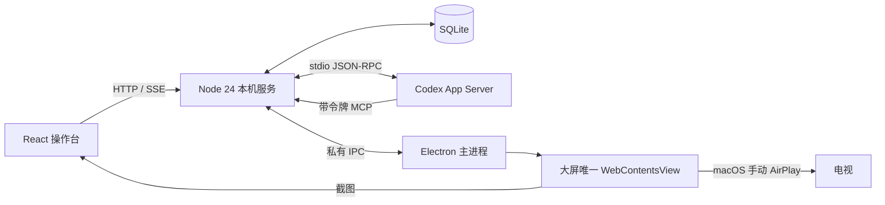

# 系统架构

## 桌面运行

Electron 启动和停止独立 Node 24 子进程，随机回环端口，内置 Node/npm。操作台与大屏都是可信 React UI；作品使用无 preload 的独立持久浏览器 session。Codex 与操作台点选均定位同一个作品页面，而非另开浏览器复制状态。完整决定、约束及数据兼容见 [ADR 0003](adr/0003-desktop-canonical-preview.md)。

保留发布静态 `preview/index.html`，冻结允许的 public 资产后切换版本；用户可在交互终端启动项目 dev server，再明确绑定 loopback URL，放行精确项目 origin 与 HMR WebSocket，仍禁止访问本机工作台服务。相同内容不刷新页面，更新保留项目来源和 localStorage。生成页面不能访问本地服务或外部网络，不支持 CDN/API。页面 uuid、项目 id、revision、导航 epoch 和元素 ref 共同约束动作；只提供 snapshot/click/type/scroll，没有任意 JS、RPC 或 shell 转发。

Codex 使用常驻 App Server 连接的线程/任务接口，默认 Manual（`workspace-write` / `on-request` / 用户审批）；可显式选择自动审查或完整访问。每轮提交前确认官方执行/计划模式与权限设置，Sidechat 固定只读。显示实际消息、命令/文件/工具进度、询问和批准。会话不等同 Codex 桌面应用已有会话。重复 task requestId 从数据库回执判断，不重放；异常重启标记未完成任务为 interrupted，等待用户核对已有文件修改。停止不会回退文件。

## 接口

| 接口                                                          | 行为                                                   |
| ------------------------------------------------------------- | ------------------------------------------------------ |
| `GET /api/health`                                             | 存活与 schemaVersion                                   |
| `GET /api/workbench`                                          | 桌面能力、项目、对话历史、选中轮次、终端与预览绑定     |
| `GET /api/workbench/events`                                   | `workbench.snapshot` SSE，连接即完整快照               |
| `POST /api/workbench/start`                                   | requestId、文字、可选版本化点选；需要桌面与项目        |
| `POST /api/workbench/decision`                                | 匹配 task/approval ID 的批准、拒绝或回答               |
| `POST /api/workbench/interrupt`                               | 中断当前任务；超时才关闭共享连接                       |
| `POST /api/workbench/action`                                  | 固定原生项目选择/窗口/发布动作，不接收任意路径或命令   |
| `POST /mcp/preview`                                           | 独立 Bearer 认证的有限 MCP；令牌每次启动生成，不给网页 |
| `GET /api/session`、`POST /api/commands`                      | 原浏览器基础模式建议保存、去重与版本冲突               |
| `GET /api/events`                                             | 基础模式 `session.snapshot` SSE                        |
| `GET /api/setup`、`POST /api/setup/check`                     | Codex/灵矽/唤醒/麦克风只读配置检查                     |
| `GET/POST /api/setup/codex/action`                            | 查询或显式 install/latest、官方 login 动作             |
| `POST /api/setup/codex/cancel`、`POST /api/setup/codex/check` | 有界取消与独立只读 Codex 检查                          |

所有写动作严格 Zod 校验。桌面任务/配置动作要求允许的本地 Origin；所有路由校验 Host/Origin，不开放 CORS。MCP 不向页面提供令牌，不能代用任意工具名或脚本。私有 IPC 只响应固定方法；preload 限于可信主框架，生成页面无 IPC 入口。

操作台滚轮通过固定 `desktop.scroll` 私有 IPC 传到唯一作品页面，校验完整绑定、归一化坐标和有界滚动量。与预览操作串行，不重试、不导航或发布；被动大屏不能调用。见 [ADR 0013](adr/0013-operator-preview-scrolling.md)。

## 状态、兼容和基础模式

SQLite WAL，`session` 表保留原版本化建议。新增 v2 `workspace_state_v2` / `workspace_turns_v2`，首次导入 v1 数据但不修改旧表。HTTP schemaVersion=1 保留，新字段有默认值，详见 ADR 0004。SSE 初始/重连发完整快照，15 秒心跳；客户端忽略旧快照。关闭服务终止流和它拥有的进程，不删除数据。

纯浏览器 `npm run dev` / `npm start` 保持基础模式：保存建议与双端同步，没有桌面 bridge，不开放 Codex 任务或作品 MCP。建议仍使用 expectedRevision 和 commandId 重试去重，过期/无效的成果目标被拒绝。数据路径和部署方法见 [部署文档](deployment.md)。

连接向导的诊断与执行分离：短时检查版本、握手、account/read，不创建线程或执行 turn；显式点击才安装或授权。不将诊断结果保存为真实语音/投屏连接状态。配置操作详见 [ADR 0002](adr/0002-local-setup-actions.md)。

灵矽 OTA 绑定、WSS PCM 音频与设备 MCP 已接入，尚无真实账号/硬件验收；本地唤醒已按需接入，系统投屏自动化尚未实现。待唤醒音频仅在本机检测，手动或唤醒后开始任务收音才上传。设计原型 `source/`、根 `dist/` 与用户项目文件隔离。

## 工作区与灵矽扩展接口

- `POST /api/workbench/workspace`：新建/选择/重命名/归档对话、Sidechat/Fork、设置、取消排队。
- `POST /api/workbench/terminal`：应用固定 shell 的打开、stdin、resize、terminate。仅桌面、合法 Origin；无 executable/argv 参数。
- `POST /api/workbench/preview-url`：显式绑定项目 loopback URL。
- `GET /api/workbench/models`：完整可见模型分页目录；只查询，不创建线程或执行任务。
- `GET /api/workbench/execution-options`：只读模式与组织权限策略能力；`POST /api/workbench/verify-execution`：显式、独立临时会话验证，等待官方设置通知，不执行模型任务。
- `GET /api/workbench/git` / `catalog`：固定只读 Git 与模型/Skills/MCP/额度查询。
- `GET /api/voice` / `binding`：无秘密状态。
- `POST /api/voice/binding`：显式 start/check/cancel；官方 OTA 网关请求，不代理任意 URL。
- `POST /api/voice/inspect|config|preferences|command`：只读配置检查、加密配置/偏好及固定语音动作；音频仅私有 IPC。

安全边界、Sidechat MCP 禁用、音频帧、存储兼容与协议来源见 [ADR 0004](adr/0004-persistent-workspace-and-voice.md)。

输入区模型选择器、上下文最近/累计统计及独立元数据表兼容见 [ADR 0005](adr/0005-model-controls-and-context-usage.md)。快照 runtime 字段来自当前对话对应的真实通知；旧 v2 状态 JSON 不写入该新字段。

每轮消耗由累计值前后差计算，在结束回复下方展示总量、输入/输出、缓存命中率。`workspace_turn_usage_v1` 独立保存基线、前驱轮次和原始累计报告，快照 `turnUsage` 按当前历史派生，旧 v2 JSON 不增加字段。已知历史轮次的迟到报告只修正对应轮次及下一轮基线，不能覆盖更新的窗口占用。数据缺失和计数重置不估算。见 [ADR 0006](adr/0006-turn-token-consumption.md)。

模式与权限映射、独立验证进程、只读能力发现、结构化目录及语音切换见 [ADR 0007](adr/0007-official-modes-and-readable-tools.md)。权限偏好与排队时捕获的选择存入 `workspace_permissions_v1`，旧 v2 状态与任务 JSON 格式不增加属性。

历史选段作为现有 text 附件进入草稿，不扩展持久 Task。选段 Sidechat 的 fork 请求额外携带来源任务、消息与原文，服务端核对当前项目/对话，连接取得后再次检查上下文；仅创建截至来源轮次的只读对话，不自动执行模型。各项目/对话的草稿只保存在页面内存，异步操作写入原定目标。详见 [ADR 0008](adr/0008-history-quotes-and-drafts.md)。

本地检测 Worker、固定模型下载、麦克风生命周期与双端上下文详情命令见 [ADR 0009](adr/0009-local-wake-and-context-controls.md)。模型按需存于用户数据目录，启用状态不持久化；公开 VoiceState 增加默认值，旧 VoiceConfig 与工作区持久格式不变。

桌面启动门控、三步向导、显式继续与只读原生/权限检查见 [ADR 0010](adr/0010-startup-configuration-checks.md)。OpenCode / DeepSeek Harness 的后续适配边界见[多引擎评估](multi-engine-options.md)，当前尚未实现这些后端。

常驻 `/settings` 复用向导表单和检查，内部切换保留工作台内存草稿、卸载音频所有者，返回不自动开麦。VoiceState 的工具发现和交接回执为临时诊断，不改变持久配置或任务格式。云端角色/工具描述与实际执行许可分别处理；只有真实任务回执显示已提交。见 [ADR 0011](adr/0011-settings-and-voice-handoff.md)。

主动语音会话跨静音/播报保持，逐句重新暂存当前上下文，手动或设备工具可关闭；故障断连不自动恢复。预览旁「批注修改」提供元素批注并进入真实任务，大屏启动默认打开，即使无项目也有空状态；AirPlay 仍由系统管理。可见品牌统一「丽塔同学」，技术标识与数据目录不变。详见 [ADR 0012](adr/0012-continuous-voice-and-preview-annotations.md)。
