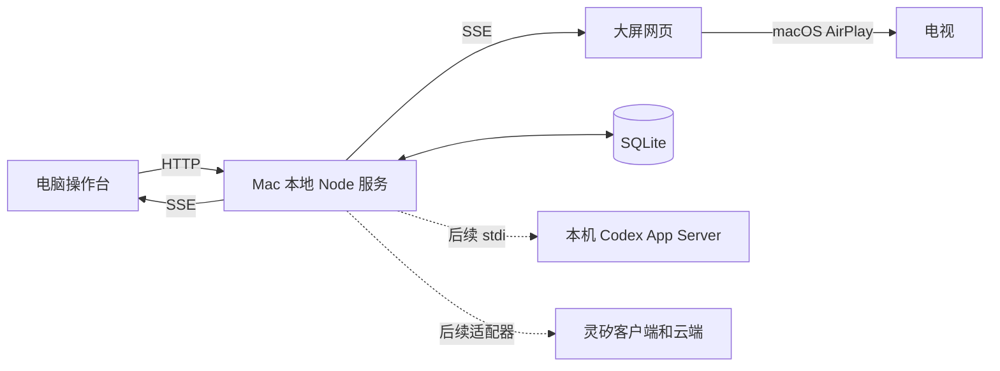

# 系统架构

## 运行与调用



浏览器负责界面；Node 服务负责系统能力。完整产品不是单独部署一个静态网页。`codex app-server` 将由本机服务启动，通过 JSON-RPC 创建会话、提交任务、接收事件、补充和中断。第一版使用工作台管理的独立会话及明确项目目录。

AirPlay 首版由用户在 macOS 手动连接，网页仅放到扩展屏幕，不实现投屏协议。虚线适配器尚未实现；当前 API 只管理建议。

## 当前协议（版本 1）

| 接口                           | 行为                                                     |
| ------------------------------ | -------------------------------------------------------- |
| `GET /api/health`              | 存活与协议版本                                           |
| `GET /api/session`             | 完整当前会话                                             |
| `POST /api/commands`           | 保存建议，首次 201、重试 200                             |
| `GET /api/events`              | `session.snapshot` SSE，初始和更新时发完整快照           |
| `GET /api/setup`               | 后端所在电脑环境与当前能力边界，不启动 Codex             |
| `POST /api/setup/check`        | 一次汇总环境、Codex 与灵矽检测结果（后者当前为无法检测） |
| `GET /api/setup/codex/action`  | 当前安装或授权操作状态                                   |
| `POST /api/setup/codex/action` | 固定 install / login 动作，requestId 去重，202 / 409     |
| `POST /api/setup/codex/cancel` | 按操作 ID 停止并回收进程                                 |
| `POST /api/setup/codex/check`  | 空 JSON 请求触发只读 CLI、App Server 和认证配置检查      |

```json
{
  "commandId": "68173935-2661-4003-9bac-6127452b9db4",
  "source": "keyboard",
  "text": "把首页标题改成周末计划",
  "expectedRevision": 0
}
```

来源支持 `keyboard / voice / pointer`；现有界面只提交键盘建议。点选还要求 `selection` 含成果 ID、成果版本、元素 ID 和标签。目前没有真实成果，无法验证的目标会被拒绝。

## 重试、冲突与恢复

逻辑提交持有 UUID，网络重试沿用 ID。相同 ID 和内容不会重复创建记录，相同 ID 内容改变返回 `409 command_id_conflict`。重复判断先于版本检查，保证成功请求的旧版本重试仍能返回结果。

新提交需匹配当前 `expectedRevision`。SQLite 立即事务内完成检查、添加和增版。落后提交返回 `409 revision_conflict`，客户端保留输入、刷新状态，供用户核对重试。选中目标必须匹配成果版本，否则 `409 selection_stale`。

SSE 使用会话版本作为事件 ID，每 15 秒注释心跳。任何重连都会收到完整最新快照，不依赖补齐旧增量。浏览器忽略旧版本快照，断线保留最后画面。

数据库默认 `.local/lingxi.db`，WAL 模式。重开数据库恢复会话 ID、建议和版本。当前没有运行中的 Agent 任务；未来恢复需核对真实执行状态。

连接向导的环境检查与持久会话分开。检查结果带时间戳，不保存成「已连接」状态，也不修改任务或会话版本。后台固定调用 CLI，限制超时和输出大小，并共享同时发起的检查；网页不能传入程序路径或参数。真正的执行与语音能力仍标为未开放。安装与登录由独立的显式点击操作完成；受控进程、工具目录和授权流程见 [ADR 0002](adr/0002-local-setup-actions.md)。

## 本地边界与成果隔离

- 服务和开发网页只绑定 `127.0.0.1`，开发时通过 Vite `/api` 代理，生产时由 Node 提供构建页面。
- 校验 Host 和 Origin，不开放通配 CORS；输入严格验证并限制长度，错误响应不泄漏堆栈。
- 当前没有任意 shell、项目文件读取或远程加入接口。后续增加能力时明确项目目录、配对和权限边界。
- 真实成果使用隔离 iframe/独立来源，生成脚本不注入工作台。预览进程和版本由服务管理。
- 选择器只在受支持的预览中运行，验证消息结构、窗口来源与成果版本。源码映射和截图都需绑定版本，不能仅传旧坐标。

`source/`、根 `dist/` 继续作为设计原型维护，不由 Agent 项目成果覆盖。
