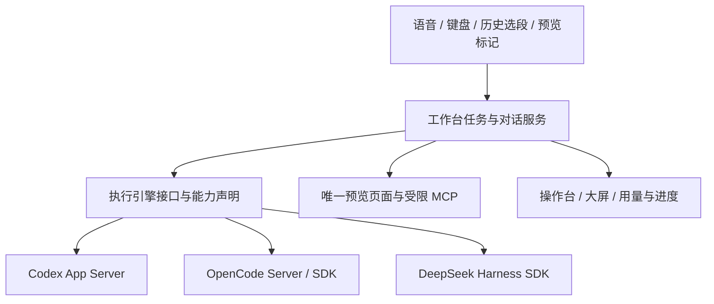

# Codex、OpenCode 与 DeepSeek Harness 接入评估

2026-10-24，基于官方文档和公开协议静态核对。当前应用只实现 Codex；本文为后续设计提案，未安装或调用另外两个引擎，也不表示功能已经互通。

## 建议

可以把工作台扩展为多个执行引擎共用的语音、大屏和预览外壳。建议先提取现有 Codex 适配器，再接 OpenCode；DeepSeek Harness 用独立 SDK 适配器跟进。每个新对话选择引擎，运行中的任务和已有原生会话保持所属引擎。

模型和执行引擎分别选择。OpenCode 已有 [DeepSeek provider](https://opencode.ai/docs/providers/)；使用 DeepSeek 模型不必先接入 DeepSeek Harness。若需要 Harness 自身的插件与工作流，则接入其运行时。各引擎使用各自的账号或提供方配置，不复用 Codex OAuth 凭据。

## 官方接口与差异

| 执行引擎         | 可用接口                                                                 | 对当前工作台的意义                                                                               | 需要单独验证                                                                              |
| ---------------- | ------------------------------------------------------------------------ | ------------------------------------------------------------------------------------------------ | ----------------------------------------------------------------------------------------- |
| Codex            | 当前 App Server stdio JSON-RPC                                           | 已实现多轮、任务、权限、终端、Diff、模型、上下文与用量                                           | 真实 Mac/模型/语音验收仍按现有指南进行                                                    |
| OpenCode         | `opencode serve` 的 HTTP/OpenAPI、TypeScript SDK；另有 ACP stdio         | 官方服务接口列出会话、消息、异步提交、停止、Fork、Diff、权限响应与事件，适合作为第二个完整适配器 | 计划/权限语义、问题回答、PTY、缓存/窗口口径与只读 Sidechat，不按 Codex 的同名控件直接推断 |
| DeepSeek Harness | TypeScript SDK / `dsh --profile sdk` 的 stdio JSON-RPC；另有 ACP profile | SDK 提供会话恢复、持久事件、收件回执、等待、权限请求与用户问题，可作为独立后端                   | 项目处于开发者预览，协议可能破坏兼容；Fork、交互终端、目录与完整用量需逐项核对            |

OpenCode 的 [Server 文档](https://opencode.ai/docs/server/) 明确列出 `/session/:id/fork`、`abort`、`diff`、权限响应与消息接口；[SDK 文档](https://opencode.ai/docs/sdk/) 给出程序化客户端。[ACP 文档](https://opencode.ai/docs/acp/) 另说明当前部分内建命令如 undo/redo 不支持，不能把 ACP 支持理解为所有产品入口自动可用。

DeepSeek 官方 [架构](https://github.com/deepseek-ai/deepseek-harness/blob/master/docs/architecture.md) 提供 web、headless、sdk、acp 等 profile。其 [SDK 协议](https://github.com/deepseek-ai/deepseek-harness/blob/master/packages/sdk/protocol/README.md) 提供 `approval/request`、`user-question/ask`、`session.event` 等接口。选择 SDK 更适合我们的交互工作台。

DeepSeek 的 [ACP 合约](https://github.com/deepseek-ai/deepseek-harness/blob/master/packages/acp/acp/README.md) 定位为自动化接口，明确省略 Fork、历史重放、模式、计划、终端和 elicitation 等能力。它适合先验证基础执行和 MCP，却不足以直接承载目前全部界面。通用 ACP 可作为共享基础传输层，丰富功能仍需专有适配。

## 适配层边界

建议接口职责：只读环境检查、模型/能力查询、创建/恢复会话、提交/排队/补充、停止、回答问题与审批、事件订阅、Fork，以及可选的终端和用量。先完整迁移现有 Codex 行为，再增加另一个引擎；本次不提前加入不可使用的引擎选择器。
- **能力声明**：分别声明模型、思考强度、计划、审批、问题、Fork、只读讨论、PTY、Token、上下文、缓存与目录查询。界面只展示真正支持的选项；未知统计沿用隐藏/未知处理。
- **真实权限**：Codex 的 Approve for me 是 Codex 自动审查，不能映射成其他引擎的自动放行。只读 Sidechat 必须可执行地限制写入、终端和 MCP，提示词不能代替边界；未验证前不提供此入口。
- **终端与 Diff**：当前 PTY 使用 Codex `command/exec`，需要拆成应用独立管理的终端或由各适配器实现；不能让用户选 OpenCode 后仍要求安装 Codex。Git Diff 与唯一页面可以共享，模型轮次 patch 仍保留来源。
- **事件归属**：统一事件保留 engine/session/turn/request 标识。DeepSeek 的 SDK 事件会涵盖运行时的多个会话，必须过滤；`session/prompt` 的 messageId 只是持久入队回执，不是任务结束。SDK `run()` 的最后回复按 idle 区间收集，不能直接当作本次输入的完成回执。
- **用量口径**：各家原始统计保留来源，分别验证多步骤累计、缓存字段、迟到报告和压缩后的窗口。DeepSeek SDK 的 `maxTokens` 是输出上限，不是上下文窗口容量。缺少报告不估算、不补假命中率。
- **进程与鉴权**：由桌面拥有并回收子进程。OpenCode 如走 HTTP，仅监听随机 loopback 端口并启用其认证；令牌留在本机服务，不交给浏览器/作品页。DeepSeek SDK 使用受控 stdio，取消、退出和故障必须回收。
- **预览 MCP 与语音**：沿用同一个页面绑定、来源/版本校验和任务入口。适配器负责把受限预览 MCP 配置到对应引擎；灵矽不用理解每家的会话协议，唤醒与音频实现也无需重做。
- **存储与切换**：新增引擎元数据须另记迁移与旧数据兼容决定；旧会话默认属于 Codex，不向严格 v2 Task 随意增加字段。原生 Fork 只在同一引擎内承诺；跨引擎可以新建对话并引用已选上下文，不能假称继承原生缓存、历史和审批。
- **向导**：实现多引擎后，只检查当前选中的执行引擎及共用语音组件，不强迫用户把三种引擎都安装/登录。模型目录与账号错误也按引擎分别报告。

## 分阶段验收

1. 提取 CodexAdapter，保留现有测试与本地数据，行为不变。
2. OpenCodeAdapter 首先闭环新建/恢复、模型选择、流式事件、停止、MCP 预览操作及权限；随后验证 Fork、问题、终端和用量，再开放相应控件。
3. DeepSeekHarnessAdapter 用 SDK 验证同样的公共契约，按其审批/问题回调、SessionEvent 和持久化语义接入；缺少的产品能力保持不可用，必要时再做专有插件。

每个适配器都要通过去重、不重放、跨会话事件过滤、取消/重启、真实文件修改与同页面操作验证。默认继续串行修改项目；并行引擎写同一目录需要先具备 worktree 或互斥策略。具体工作量应由各家的真实 CLI 小范围验证后估计。
